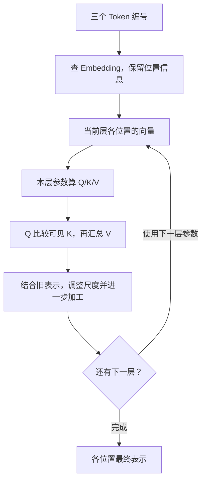

# LLM 前置一：模型与 Transformer

假设你在写一个服务：用户输入“对象存储很”，服务接着输出“快”，再输出“。”。普通字符串服务可以查询一张补句表，但问题一换、前文一变，表就很难覆盖。我们接下来要理解的程序，要解决的就是在没有人为穷举所有句子的情况下，根据已经出现的文字，计算接下来可能出现什么。

本篇只要求你会看数组、循环和乘加运算。我们一直跟踪这条补句请求，先看问题与数据，再给已经理解的机制起名字。**“快”只是本例选出的文字，不是对对象存储性能的判断。** 所有编号、向量和小矩阵都为教学构造，不是某个真实模型的内部数据。

**第一遍阅读：**按 §1～10 阅读，再接第二篇。§11 是进阶选读，保留精确公式、训练数学和结构边界，第一次可以整段跳过。主线不会要求先掌握选读部分。

## 1. 程序除了执行人写的规则，还能怎样解决问题

你可以写 `if input == "对象存储很": return "快"`。这类程序的行为主要由开发者明确写出的规则决定。另一条路是给程序大量例子，让它调整内部一些数值，逐渐学到哪些输出更符合这些例子。后一种方式叫**机器学习（Machine Learning）**：执行计算的代码仍由人设计，但部分决定行为的数值由数据学习得到。

**人工智能（AI）**是更宽的领域，研究让计算机完成语言理解、图像识别等任务；机器学习是其中一种方法。AI 也包含主要靠人写规则的方法，不都通过例子调整内部数值；学习程序也不都生成文字。这里关注的是用学习方法生成语言的程序。

只把输入乘一个固定数再加另一个固定数，能表示的输入输出关系很有限。想处理更复杂的关系，可以让一个计算的输出成为下一段计算的输入，并在中间增加例如“负数改成 0，正数保留”的操作。

比如先算 `u=2×x-1`，再算 `h=max(0,u)`，最后算 `y=3×h`。输入 x=0 时，u=-1、h=0、y=0；输入 x=1 时，u=1、h=1、y=3；输入 x=2 时，u=3、h=3、y=9。输入连续各增加 1，输出先增加 3、再增加 6，变化比例不固定。这条关系不再是一条从头到尾不拐弯的直线。这样的操作叫**非线性变换**，作用是让程序能够表示更复杂的关系。

把许多内部数值可以调整的计算单元连接起来，就得到**神经网络（neural network）**。这个名字借用了生物概念；运行在计算机上时，它仍是数值运算，不需要把它想成真实大脑。把单元按阶段组织，每个阶段通常叫一**层（layer）**：本层读上一层结果，产生下一层输入。使用较多计算层的机器学习通常称为**深度学习（deep learning）**。

<a id="model"></a>

## 2. 模型里哪些数可以调整

先用一个能手算的函数理解“调整数值”。设程序执行：

```python
y = w * x + b
```

x 是每次请求的输入；w 和 b 是程序内部保留的两个数。如果 w=2、b=1，输入 x=3，输出就是 `2×3+1=7`。换成 x=4，则得到 9。这里无需新增 if 分支，只需复用相同的运算和内部数值。

w、b 这种可以在学习过程中调整的数叫**模型参数（parameter）**，不是 HTTP 请求参数。运算规则加上这些参数，就构成一个可执行的**模型（model）**。实际生成文字的程序有大量这样的运算与数值，不能用这个二参数函数完成聊天，但“输入变化、内部数值复用”的关系相同。

乘在输入上的 w 通常叫**权重（weight）**，加上的 b 常叫偏置。在讨论完整模型文件时，人们也常用“模型权重”统称需要加载的已学习参数，包括其他类型的参数。不要把权重想成每个单词的一条说明文本：它们首先是参与计算的数值。

<a id="training"></a>

## 3. 从例子调整参数，与用固定参数回答问题

假设有两条已知例子：输入 1，希望得到 3；输入 2，希望得到 5。开始时 w=1、b=0，程序分别输出 1、2，与目标差得很远。把 w、b 调到 2、1 后，它就能输出 3、5。由例子反复计算误差、调整参数的过程叫**训练（training）**。

这不是说实际训练靠人手动尝试两个数字。实际程序会自动计算调整方向，并用很多样本反复更新；其中的数学方法放在 §11。现在先明确：**训练的结果是参数变了，执行时仍是那些定义好的运算。**

对文字也是这个思路。训练文本中某一处已有“对象存储很”，接下来真实出现“快”。程序尝试给各种后续文字评分；如果给正确后续的评分太低，训练就调整参数。实际训练不会只记这一句，也会遇到大量不同上下文。评分与文字编号的计算稍后逐步展开。

训练完成后，服务加载一组确定的参数，用它们处理新输入，这叫**推理（inference）**。一次从输入开始，按顺序执行模型运算、得到结果的过程叫**前向计算（forward pass）**，可以先理解成一次函数调用。

训练也包含前向计算，用来先看当前模型答得怎样；之后还有参数调整。通常的在线推理只做回答所需的计算，不调整参数。因此“用户问过一次，程序留下一些中间数组”和“模型学会了新知识”是两件事。

保存训练进度供故障后恢复的文件集合，叫**检查点（checkpoint）**。它可能不仅保存模型参数，还保存参数调整过程需要的状态。上线推理通常加载回答所需的权重与配置，不需要把整套训练状态都带上。

面向文字、学习如何预测后续文字的模型叫**语言模型（language model）**。其中规模很大的模型常称为**大语言模型（LLM，Large Language Model）**。“大”主要描述模型规模，并不代表它一定正确，也不等于每次请求都要更新参数。

看到 7B、70B 时，B 是十进制 billion（十亿）：7B 通常表示约 70 亿个参数，70B 约 700 亿个。它不是 GB，也不是训练句子的数量。参数有多少与一次请求会产生多少中间状态，还不能画等号。

<a id="token-embedding"></a>

## 4. 回到这条请求：先把文字编号

我们的输入是“对象存储很”。上面的函数只能读数值，不能直接把汉字拿去相乘。第一步是把文字切成片段，并为每个片段分配编号。假设本例的规则为：

| 文字片段 | 编号 |
|---|---:|
| 对象 | 41 |
| 存储 | 87 |
| 很 | 12 |
| 快 | 55 |
| 。 | 9 |

于是输入变成 `[41,87,12]`。模型若输出编号 55，服务就把它转换回“快”。这套规则中的一个文字片段叫**Token**；负责按规则把文本转换成编号、再把编号还原为文本的组件叫**Tokenizer（分词/编码器）**。

实际 Tokenizer 的切分方法可能与这个表不同，一个 token 可以是一个字、一段字节、一个词的一部分或标点，不保证一个汉字就是一个 token。容量计算必须使用实际切出来的 token 数。本例始终按“对象 / 存储 / 很”三个 token 走，不换成另一种切分。

所有可用 token 编号及其对应片段组成**词表（vocabulary）**。编号 87 大于 41，并不意味着“存储”比“对象”更重要：编号像枚举 ID，主要用于寻址，不能直接当成文字含义的大小。

<a id="tensor-basics"></a>

## 5. 模型读什么数组：向量、矩阵与 Tensor

为了用计算表达每个片段，模型需要给它一组数值。先看普通数组 `[1.0,0.0]`：有两个坐标，这样的一维数值数组叫**向量（vector）**；坐标数 2 常称为它的维度。这里“向量”不是要求你先学线性代数，而是先会读一行数。

把几行这样的数组放在一起，就得到二维数值数组，叫**矩阵（matrix）**：

```text
[[1.0, 0.0],
 [0.0, 1.0],
 [1.0, 1.0]]
```

它有 3 行、每行 2 个元素，**形状（shape）**写成 `[3,2]`，总共 `3×2=6` 个数。这和 `float[3][2]` 的逻辑组织很接近。注意 `[3,2]` 若是 shape，表示数组的大小；若是数组值，就表示两个具体数字，要看上下文。

一个数、向量、矩阵以及更多维度的数值数组，都可以放在**Tensor（张量）**这个统称下。工程中它还带有形状、元素类型等信息。比如元素用 32 位浮点数还是 16 位浮点数，这个**数据类型（dtype）**会影响字节数，第三篇再算。

模型经常用矩阵把输入数组变成另一组数组。先把一次运算展开，不直接抛公式：

```text
输入行：[x1,x2]，参数矩阵：[[2,0],[1,3]]
输出的第一个数 = x1×2 + x2×1
输出的第二个数 = x1×0 + x2×3
```

输入 `[1,2]` 得到 `[4,6]`。把每行都如此处理，就是**矩阵乘法**。若输入有 3 行，每行 2 个数，参数矩阵有 2 行、每行 2 个数，结果仍是 3 行、每行 2 个数。中间的两个“2”必须相等，因为每个输出都需要把对应的乘积相加。

更一般地，输入形状 `[m,k]` 乘参数形状 `[k,n]`，输出形状为 `[m,n]`。m 是输入行数，k 是每行参与相乘的元素数，n 是输出行宽；都表示元素个数，没有字节单位。稍后生成 Q/K/V 的运算正是这种数组变换。

<a id="embedding"></a>

## 6. 由编号查到一行数，再记住位置

现在给词表中的每个编号配一行可学习的数值。本教学表有：

| 编号 | 片段 | 查到的向量 |
|---|---|---|
| 41 | 对象 | `[1,0]` |
| 87 | 存储 | `[0,1]` |
| 12 | 很 | `[1,1]` |

输入 `[41,87,12]` 就查出上一节那个 `[3,2]` 的矩阵。这一步叫**Embedding（嵌入）**：把离散编号映射成参与后续计算的向量。整张表也是模型参数的一部分，训练会调整表中的数。`[1,0]` 并不是人为规定“1 表示对象、0 表示速度”；真实向量的各坐标通常没有这么直接的文字标签。

如果词表有 100 个编号，每行有 2 个数，整表就有 `100×2=200` 个参数。但本请求只查 3 行，得到 6 个输入数。**跨请求共享的表，与本次取出的数组，不是同一个生命周期。**

还缺什么？“从 A 复制到 B”与“从 B 复制到 A”包含相似片段，顺序却改变意思。模型必须使用位置信息，而不能只把各片段的向量相加、丢掉顺序。实际模型会把位置带入后续计算；一种方式是添加位置相关的向量，另一种是按位置调整后面用于匹配的数组。

下面为便于手算，只展示这个三位置例子的内容向量与可见位置，不展开位置调整的具体数字。真实缓存复用仍必须匹配位置条件，不能把教学中的省略当成“位置不影响结果”。

<a id="attention"></a>

## 7. 当前片段怎样借助前文：先看需要解决的问题

只看“很”这个片段，很难决定后面接“快”还是“慢”。模型必须结合“对象”“存储”和其他上下文。因此一个位置的计算不能永远只处理自己的初始向量，还需要从其他位置取信息。

假设当前“很”这一位置分别给三个可见位置分配了 `[0.1,0.2,0.7]` 的关注比例，它们相加为 1。若三个位置提供的内容向量是 `[10,0]、[0,10]、[10,10]`，取回的结果就是：

```text
第一坐标：0.1×10 + 0.2×0  + 0.7×10 = 8
第二坐标：0.1×0  + 0.2×10 + 0.7×10 = 9
结果：[8,9]
```

这种“比较当前需要与各位置信息，算关注比例，再按比例汇总”的机制叫**Attention（注意力）**。这些比例由模型计算出来，会随输入和当前位置改变；上面暂时给定比例，下一节解释它从哪里来。

这里的关注比例也常被叫作“attention 权重”。它们是一次输入计算出来的临时比例，**不是 §2 所说的、保存在模型文件中的可学习参数**。同一个“权重”一词有两种用法，必须看对象。

为了预测后续文字，一个位置只能用已经出现的内容。“存储”可以使用“对象”和自己；“很”可以使用三者；“对象”不能提前使用后面的“很”。这种禁止看未来位置的规则叫**因果注意力（causal attention）**。把不可用位置排除的规则或数组叫**Mask（掩码）**。它是可见范围的控制，不是给某个词永久贴上“不重要”的标签。

<a id="qkv"></a>

## 8. 关注比例从哪里来：Q、K 与 V 分工

为避免只凭片段编号做比较，模型把每个位置的当前向量分别变成三组数组：一组描述当前需要什么，一组供别人比较，一组提供实际要汇总的内容。它们分别叫 **Q（Query，查询）、K（Key，匹配用的键）、V（Value，汇总用的值）**。这三个英文名字描述注意力中的角色，不是 S3 对象的字符串 key 和 payload。

仍使用我们的三个向量，下面给三组教学参数矩阵：

```text
WQ = [[0.5,0],[0.5,0]]
WK = [[1,0],[0,1]]
WV = [[10,0],[0,10]]
```

对每个位置用 §5 的行与矩阵乘法计算。例如“很”的当前向量是 `[1,1]`：

```text
Q = [1×0.5+1×0.5, 1×0+1×0] = [1,0]
K = [1×1+1×0,     1×0+1×1] = [1,1]
V = [1×10+1×0,    1×0+1×10] = [10,10]
```

同样处理前两个位置，得到：

| 位置 | 当前输入向量 | K | V |
|---|---|---|---|
| 对象 | `[1,0]` | `[1,0]` | `[10,0]` |
| 存储 | `[0,1]` | `[0,1]` | `[0,10]` |
| 很 | `[1,1]` | `[1,1]` | `[10,10]` |

WQ/WK/WV 是模型保存的参数；表中的 Q/K/V 是这条输入算出来的结果。一次矩阵变换也常称为**线性投影**，这里就是已经会算的“乘参数矩阵”，不需要把“投影”当成一门新课。

当前“很”的 Q 为 `[1,0]`。将它与三个 K 逐坐标相乘并相加，得到匹配分数 `[1,0,1]`：例如与“存储”的 K 比较是 `1×0+0×1=0`。这个“对应相乘再求和”的运算叫**点积（dot product）**。

模型再把分数转换成非负、总和为 1 的比例，才能加权汇总 V。标准注意力还会按向量长度缩放分数，并用 **Softmax** 完成这种比例转换；其精确数字在 §11.1。主线先记住：Q 与 K 决定关注多少，V 决定汇总什么，最后得到一个结合上下文的新向量。§7 的 `[0.1,0.2,0.7]` 只是说明加权汇总；本组实际参数算出的比例约为 `[0.401,0.198,0.401]`，结果约 `[8.02,5.99]`。

如果当前查询 Q 换了，匹配比例也会改变。因此上一轮的加权结果不能代替所有历史 K/V；要重新比较时，仍需要原来的匹配特征和内容数组。

<a id="layer"></a>

## 9. 把注意力放进完整计算层：Transformer

Attention 得到了结合前文的新信息，接下来还要将它与原表示结合，并继续变换。常见做法是把旧向量与新计算的修正相加，叫**残差连接（residual connection）**，相当于保留旧信息，再加上本轮更新。

层内还会调整一组数的尺度，避免数值随着多层运算过度漂移，这类操作叫**归一化（normalization）**。它有不同具体实现，这里只需知道它会对向量数值做调整，不是给 token 改编号。

此外，每个位置会独立经过一个小网络，常用“矩阵变换 → 非线性操作 → 再变换”来加工其表示。它叫**前馈网络（FFN，Feed-Forward Network）**：attention 负责从其他位置获取信息，前馈部分进一步加工每个位置得到的结果。实际顺序和公式可能不同，但这两个角色应分开。

把这些机制组织起来、重复执行多层，就构成一种常用的神经网络架构，叫 **Transformer**。它不是一个模型名称，也不是缓存协议；不同模型可以采用这种架构并使用不同参数。



第 1 层读初始向量；第 2 层读第 1 层已经结合上下文的结果。每层有自己的参数与 Q/K/V。即使两个请求都出现“很”，只要前文不同，后续层中“很”的表示、K/V 通常就不同。不能为 token ID 12 永久保存一份通用 K/V 来服务所有句子。

<a id="next-token"></a>

## 10. 怎样从最后一个向量得到“快”

现在三个输入位置都完成了多层运算。服务要接着生成文字，就使用最后位置“很”的最终向量，再通过一组模型参数变换，为词表里的每个候选 token 算一个分数。这个尚未归一成概率的分数叫 **Logit**，所有候选分数组成一个数组。

再用前面介绍的 Softmax 把这些分数变成总和为 1 的概率。假设本例最终给“快”0.6、“慢”0.3，其他候选合计 0.1。**这组输出概率也是教学假设，不能从上一节某一个 attention 向量直接推出**：还缺其他层和输出参数。

可以选择概率最高的“快”，这种选择方式叫**贪心选择（greedy）**；也可以按概率随机抽取，叫**采样（sampling）**。采样不是重新训练，即使同一输入产生不同输出，权重仍可能完全相同。

服务选出编号 55，Tokenizer 将它转回“快”，用户就看到第一个输出片段。下一步必须处理“对象存储很快”，才能判断再接什么。怎样省掉对前三个片段的重复处理，是[第二篇]({{ site.baseurl }}/docs/00b_LLM_Inference/)的核心。

到这里，你已经走完文字→编号→向量→上下文汇总→多层变换→候选分数→输出文字的主线。第一遍可以在这里停下，把这个过程用自己的话讲一遍，再继续第二篇；下面的精确数学和结构名词可以后读。

<a id="advanced"></a>

## 11. 进阶选读：把主线里的简化展开

### 11.1 关注比例的精确计算

继续 §8 的同一组 Q/K/V，而不是换一个例子。Q 与三个 K 的点积是 `[1,0,1]`。每个向量有 D=2 个元素，标准做法先除以 `√D=√2`，得到 `[0.707,0,0.707]`。缩放是为了控制较长向量累加后分数变大的影响。

Softmax 的算法是：对每个分数 s 计算指数 `exp(s)`，再除以所有指数之和。exp 是以数学常数 e≈2.718 为底的指数函数；这里 `exp(0)=1`，`exp(0.707)≈2.028`。于是总和约为 `2.028+1+2.028=5.056`，得到比例 `[0.401,0.198,0.401]`。

按这些比例汇总同一组 V，第一坐标是 `0.401×10+0.198×0+0.401×10≈8.02`，第二坐标约 5.99。指数函数把分数变成正数，除以总和保证比例加起来是 1；它并不证明这些比例就是人类认为正确的理解。

对许多查询一起计算，可写成：

$$
A=\operatorname{softmax}\left(\frac{QK^\top}{\sqrt D}+M\right),\qquad O=AV
$$

Q 每行是一条查询；K 每行是一处匹配特征；`Kᵀ` 是把行列交换后的矩阵，让乘法一次算出所有点积。D 是一个匹配向量的元素数。M 用来排除不可见位置：允许位置加 0，禁止位置在数学表达中加负无穷，转换为比例后就是 0。A 的每行是关注比例，O 是汇总结果。这些是数值数组，不是容量或时间单位。[原始 Transformer 论文](https://arxiv.org/abs/1706.03762)给出该机制；本文用它讲解生成文字的模型，不照搬原论文的完整翻译模型结构。

### 11.2 训练中的“梯度”与“反向传播”究竟做什么

回到 §3，训练需要知道参数该往哪边调。只看一个参数：输入 x=1，希望输出 2，模型暂用 `y=w×x`。w=1 时输出 1。把误差平方作为一个评分，叫**损失（loss）**，此时 `(1-2)²=1`；改成 w=1.1，损失 `(1.1-2)²=0.81`。参数增加 0.1，损失下降 0.19，说明在此处增大 w 有帮助。

当参数做很小变化时，“损失改变多少 ÷ 参数改变多少”的变化率，叫损失对该参数的**梯度（gradient）**。若只增加 0.01，损失从 1 变成 0.9801，变化率为 -1.99；只增加 0.001 时为 -1.999。变化越小，这个比值越接近 -2，因此本例在 w=1 处的梯度是 -2；负号说明往增大 w 的方向移动会使损失下降。按 `新参数 = 旧参数 - 步长×梯度`，若步长取 0.1，新 w=`1-0.1×(-2)=1.2`。步长控制每次调整幅度，梯度不是新的模型权重。

多层网络有许多参数。程序先做前向计算并求损失，再从输出往回计算：输出误差怎样随中间结果变化，中间结果又怎样随各参数变化，把这些依赖合起来得到各参数的梯度。这种沿依赖逆向计算的方法叫**反向传播（backpropagation）**；根据梯度和更新规则调整参数的组件叫**优化器（optimizer）**。数学细节不是理解 KV 的前提，但它解释了为什么训练还需要保存中间结果、梯度和更新状态，而普通推理通常不用这些训练状态。

概率评分也常采用另一种损失 `-ln(p)`：p 是模型给正确答案的概率，没有字节或时间单位；ln 是自然对数，即指数 exp 的逆运算。p=0.1 时约为 2.30，p=0.8 时约为 0.22，因此给正确答案更高概率会使这个损失降低。无需为了推理存储继续推导这条损失的梯度。

<a id="heads"></a>

### 11.3 多套关注通道：MHA、GQA 与 MQA

§8 只计算了一套匹配与汇总。实际模型通常同时使用多套通道，让每套通道产生自己的查询与信息组合。每套通道叫一个**Attention Head（注意力头）**；它不是一个 token，也不是一张 GPU。各通道输出会组合后再变换。

假设有 32 套 Q 通道，每套向量长 D=128。有三种常见组织：

| 结构名 | Q 通道数 Hq | K/V 通道数 Hkv | 共享关系 |
|---|---:|---:|---|
| MHA，多头注意力 | 32 | 32 | 每套 Q 使用自己对应的一套 K/V |
| GQA，分组查询注意力 | 32 | 8 | 每 4 套 Q 共用一套 K/V |
| MQA，多查询注意力 | 32 | 1 | 所有 Q 共用一套 K/V |

相同层数、token 数、向量长度与保存类型下，需要保存的 K/V 通道越少，状态越小。这是第三篇容量算例选 Hkv=8 的原因。减少 K/V 不会使所有模型参数按同样比例减少；也不能把已训练模型的配置任意改成另一种结构就保证结果不变。[GQA 论文](https://arxiv.org/abs/2305.13245)讨论相应结构与转换训练。

在本仓库的较大教学模型中，输入向量宽度记为 `d_model=4096`，Q 有 `32×128=4096` 个坐标，K/V 各有 `8×128=1024` 个坐标。因此一层的 Q 参数矩阵可以是 `[4096,4096]`，K、V 参数矩阵各为 `[4096,1024]`。这是例子的尺寸约定，不是所有模型必须满足的公式。

### 11.4 常见架构限定词可以怎样读

**自回归（autoregressive）**指输出按步骤生成：先选一个新 token，再把它加入已有序列，用来预测下一个。我们补出“快”，再处理它以继续生成“。”，就是这种过程。第二篇将完整跟踪每轮状态。

**Decoder-only** 是一种生成模型组织方式：用已有 token 序列直接产生后续 token。Decoder 在这里指这部分生成网络，不是解压缩算法；“only”用于区别另有独立输入编码网络的组织方式。读本教程不需要先实现另一种结构。

**全因果注意力**指每个位置能使用自己与所有此前位置；有些模型只保留或使用最近一段位置，它们的状态预算就不同。**Dense Transformer** 中 dense 通常用于区分“每个位置经过该层固定整套前馈参数”与“先从多组前馈参数里选一部分使用”的设计，不表示数组没有零，也不取消因果可见范围。

四篇以普通逐 token 生成、各层保留 K/V 的模型为基线。具体模型有其他结构时，先检查它实际保存什么数组，再算容量，不靠这些限定词替代机制判断。

<a id="why-cache"></a>

## 12. 主线回顾：下一步为什么要研究中间状态

模型参数跨请求复用，当前表示与 Q/K/V 随输入计算而来；每一层还各有一套。预测“快”以后，这些已经算过的结果怎样供下一步使用？为什么有些可以保留，有些不能代替历史？[第二篇的请求时间轴]({{ site.baseurl }}/docs/00b_LLM_Inference/#prefill-decode)会接着回答，再引入 KV Cache。

试着沿“对象存储很”解释：为什么编号不能直接当含义，为什么查到向量后还要结合前文，为什么换一句话不会自动改变模型文件。若能解释这些因果关系，就继续；不要求第一次背出注意力公式或梯度公式。
