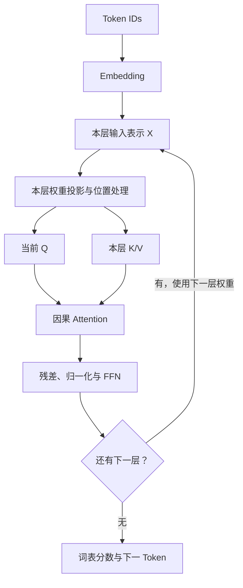

# LLM 前置一：模型与 Transformer

你熟悉 Java/Go 服务和对象复制，但不需要先学过机器学习。本篇从“程序如何把文字变成计算”开始。四篇前置使用**常规 decoder-only、自回归、全因果注意力的 dense Transformer**；所有小矩阵和硬件数字都是教学输入，不对应某个产品实测。先理解这一基线，再读已有主教程的特殊情况。

## 1. 模型究竟是什么：结构加上学出来的数值

普通服务由开发者写规则，例如 `if size > limit: reject`。语言模型也有确定的执行代码，但我们很难手写所有“看到这段话应接什么”的规则。于是定义一个带大量可调数值的函数，用文本样本调整这些数值，让它能预测接下来的内容。

可以写成 `scores = model(token_ids, weights)`：输入是整数数组，输出是词表中每个候选 token 的分数。**模型结构**规定执行哪些运算、多少层、各数组多大；**参数**是可学习的数值槽位；**权重 weights**通常指这些参数训练后的值，广义也包含 embedding、归一化参数等。模型文件保存数值，推理引擎负责执行结构。只有权重字节而没有正确结构、tokenizer 和配置，就像有序列化对象却没有兼容的类定义，不能正确运行。

先看只有两个参数的函数：`y = w × x + b`。若 `w=2,b=1,x=3`，输出就是 7；`w,b` 是跨输入复用的参数，`x,y` 是一次调用的数据。神经网络把这种变换扩成多维数组，并穿插非线性运算。下面的计算展示机制，不是语言模型的完整实现：

$$
[x_1,x_2]
\begin{bmatrix}2&0\\1&3\end{bmatrix}
=[2x_1+x_2,\;3x_2]
$$

输入 `[1,2]` 得到 `[4,6]`。矩阵的四个数是权重；输出的两个数是本次计算的中间结果。后文 Q/K/V 就来自类似变换，而不是从存储系统查出的字符串键值对。

**7B/70B** 的 B 是 billion，十进制十亿。约 7B 意味着约 70 亿个参数，通常是规模简称，不是 7 GB，也不是 70 亿条训练样本，更不能直接确定层数或 KV 大小。若恰有 `7×10^9` 个参数、每参数占 2 bytes，裸权重就是 `14×10^9 bytes = 14 GB ≈ 13.04 GiB`。70B 同条件约 140 GB。实际文件还可能有元数据、量化 scale、分片和格式开销；整个服务还要放 KV 与工作空间。[显存篇]({{ site.baseurl }}/docs/00c_Tensor_Memory/#memory-budget)会把这些分开算。

## 2. 训练与推理：什么时候改变权重

假设教学样本的 token 是 `[A,B,C]`。训练可以用 A 预测 B，用 A、B 预测 C。模型给正确答案分配的概率越低，误差越大；例如正确答案概率 p 对应的损失 `-ln(p)`，p 从 0.1 提升到 0.8 时，损失从约 2.30 降到约 0.22。反向传播计算哪些参数应如何调整，优化器执行更新。无需推导梯度，但要理解：**训练读取样本，产生中间状态和梯度，反复改变参数**。

推理则加载确定版本的权重，对新输入做前向计算，再从候选分布选择 token。通常不求梯度、不更新权重。一次聊天产生 KV 不等于模型在学习；关闭请求、释放 KV，也不等于删除模型知识。

| 数据 | 属于谁 | 为什么访问存储 |
|---|---|---|
| 训练文本/样本 | 数据集 | 持续读取，可能 shuffle、预处理 |
| 权重 | 模型版本 | 服务启动/版本切换时加载，暖服务共享常驻 |
| 训练 checkpoint | 某训练进度 | 保存恢复所需的权重、优化器等状态 |
| 推理 KV | 具体输入前缀及计算条件 | 首先是内存状态，有复用价值才选择外移 |

模型“知道上海”通常是参数中的分布式数值模式，不是内置数据库的一条记录；它可能生成错误答案。RAG 可以另外取回文档放进输入，那些文档又成为本次请求的数据。这里不展开 RAG，重点是不能把权重、原始文本和 KV 当成同一种对象。

## 3. 从文字到 Token，再到向量

计算单元不能直接对汉字做矩阵乘法。tokenizer 按词表与编码规则把字符串分成片段，再映射为整数 ID。例如假设某 tokenizer 把“对象存储很快”变成 `[41,87,12]`；这些数字只是教学占位，真实切分必须运行具体 tokenizer。一个 token 可能是字、词的一部分或标点，因此字符数不能直接充当 token 数。

词表大小 V 表示可能的 ID 数量。**Embedding** 是一个形状为 `[V,d_model]` 的可学习表：输入 ID 后取出一行浮点数。若 `V=100,d_model=4`，整表有 400 个参数，三个 ID 查出 `[3,4]` 的矩阵。ID 87 不是数值大小“比 41 更有意义”；其意义来自学出来的向量与后续计算。

模型还必须区分顺序。“A 把 B 复制到 C”和“C 把 B 复制到 A”不能只按词袋处理。位置处理提供序列坐标；有的模型给表示加位置向量，有的在 Q/K 上使用旋转位置编码（RoPE）。本教程不推导 RoPE，但后续缓存必须保留匹配的位置语义，不能把同样 token 在任意位置的 KV 当成相同。

## 4. Transformer Layer 如何逐步更新表示

Layer 是模型结构中的一层计算，不是存储分层。一层先让每个位置通过 attention 汇总可见上下文，再通过前馈网络（FFN/MLP）转换表示，配合归一化与残差。FFN 常先把向量扩到更宽维度、经过非线性再投影回来；它主要处理每个位置的特征，attention 负责位置间的信息交换。

残差可以理解成 `新表示 = 旧表示 + 本次计算的修正`；归一化调整数值尺度，使多层计算更稳定。具体模型可能采用不同顺序或门控 FFN。本篇不靠背架构变体理解 KV。

图中返回 X 是进入**下一层的独立计算**。第 2 层输入已经吸收第 1 层的上下文信息；因此第 2 层 KV 与第 1 层 KV 不同。最终表示经过输出投影变成 V 个词表分数（logits），经 softmax 得概率，再由 greedy 或采样规则选择 token。选择规则决定输出，不改变本次已经计算出的权重。

## 5. Q/K/V：一次匹配和信息汇总的计算

对本层输入表示 X，用三组权重得到 `Q=XW_Q`、`K=XW_K`、`V=XW_V`。Q（Query）提出当前查询，K（Key）提供各位置的匹配特征，V（Value）提供要汇总的内容。它们是浮点向量，名称与对象存储 key/value 的含义不同。

先只看一个 head，向量长度 D=2。当前 `q=[1,0]`，三个可见位置的 K 为 `[1,0]、[0,1]、[1,1]`。点积是逐坐标相乘再相加，所以三个分数是 `[1,0,1]`。除以 `√D=√2` 得 `[0.707,0,0.707]`；这个缩放用于控制随维度增长的分数尺度。再取指数、除以指数之和，使权重为正且总和为 1，得到约 `[0.401,0.198,0.401]`。

若三个 V 分别是 `[10,0]、[0,10]、[10,10]`，输出约为 `[8.02,5.99]`，因为第一坐标是 `0.401×10+0.198×0+0.401×10`。模型学的是投影与后续变换，不是人为规定这些 V 表示哪些单词。下一位置的 q 改变，会重新得到不同的权重与汇总结果。

推广到多位置就是：

$$
A=\operatorname{softmax}\left(\frac{QK^\top}{\sqrt D}+M\right),\qquad O=AV
$$

Q 的每一行是一条查询，K 转置后每一列对应一个位置；矩阵乘法同时算所有查询对所有 key 的点积。D 是一个 head 的坐标数；M 是因果 mask，允许位置加 0，禁止访问的未来位置加负无穷，softmax 后其权重为 0。A 是匹配权重，O 是 V 的加权汇总。Q/K/V 的几何数量不同于这条公式中的 mask 或缩放；容量公式的 2 则来自 K、V 两份数组。[原始 Transformer 论文](https://arxiv.org/abs/1706.03762)给出 attention 机制；这里用它解释 decoder-only 基线，不把原论文的 encoder-decoder 完整结构当成所有 LLM。

## 6. 多个 Head：为什么 GQA 改变 KV 容量

一个 head 是一套匹配通道；多个 head 可以学习不同关系，输出汇合后再投影。教学模型固定 `Hq=32,D=128,d_model=4096`，这里 `32×128=4096`。这是本例结构，不是所有模型必然满足的约束。

| 结构 | Q heads Hq | KV heads Hkv | Q 如何使用 K/V | 同条件 KV 大小 |
|---|---:|---:|---|---:|
| MHA | 32 | 32 | 一个 Q head 对应一套 K/V | 32 份 |
| GQA | 32 | 8 | 每组 4 个 Q heads 共用一套 K/V | 8 份 |
| MQA | 32 | 1 | 32 个 Q heads 共用一套 K/V | 1 份 |

GQA 不是只有 8 个 Q，也不是把上下文长度缩成四分之一，而是减少保留的 K/V 通道。在本例中 `W_Q` 有 `[4096,4096]` 个元素，`W_K` 与 `W_V` 各为 `[4096,1024]`，因为 `8×128=1024`。减少 Hkv 可减少 KV payload，却不能推断整个模型权重也按同样比例减少：FFN、embedding 等还在。

这是架构/训练选择，不能随意把已训练 MHA 模型的配置改为 GQA 就保证等价结果。[GQA 论文](https://arxiv.org/abs/2305.13245)讨论共享结构及转换训练，本文只需要它的 head 与容量含义。

## 7. KV Cache 为什么能成立

输入 `[A,B,C]` 时，C 的 Q 可以读 A、B、C 的 K/V，而 A 看不到 B、C。在**因果注意力、权重和位置规则保持相同**时，追加 D 不会改变 A、B、C 已算出的各层状态。于是保存每层旧 K/V，处理 D 时只计算 D 的新状态，再让 D 的 Q 读取历史 KV。

旧 Q 已经完成旧位置的查询，未来位置用自己的 Q。旧 attention 输出也不能代替历史 KV，因为新 Q 会产生新的匹配权重。**缓存省的是重复构建历史状态；每步仍要读取历史状态并做 attention。**

若把 B 改为 B'，B 及后面的 C、D 表示通常都要重算；同一个 C 处在不同前文中不能按 token ID 单独命中。KV 身份至少要关联模型权重、实际 token 前缀、位置及相关执行条件。这种输入相关、可重算、体积巨大的状态，就是存储工程开始介入的原因。[官方缓存机制说明](https://huggingface.co/docs/transformers/main/cache_explanation)用于核对依赖关系。

## 8. 读完后的自检

遮住正文，解释“权重常驻，输入变化，为什么 KV 必须按请求或兼容前缀管理？”答案应包含：权重定义变换，KV 是输入经各层变换产生的结果；相同模型不意味着所有请求 KV 相同。

再答两题：7B 是否足以算 KV？不够，还要层数、KV heads、head dimension、KV dtype、实际 tokens。缓存旧 V 是否足够？不够，新 Q 还要用旧 K 决定每个位置的权重。

你现在应能沿文字→ID→向量→多层 attention→词表分布解释一次前向。请求怎样重复调用这条路径，见[推理与生命周期]({{ site.baseurl }}/docs/00b_LLM_Inference/)。
