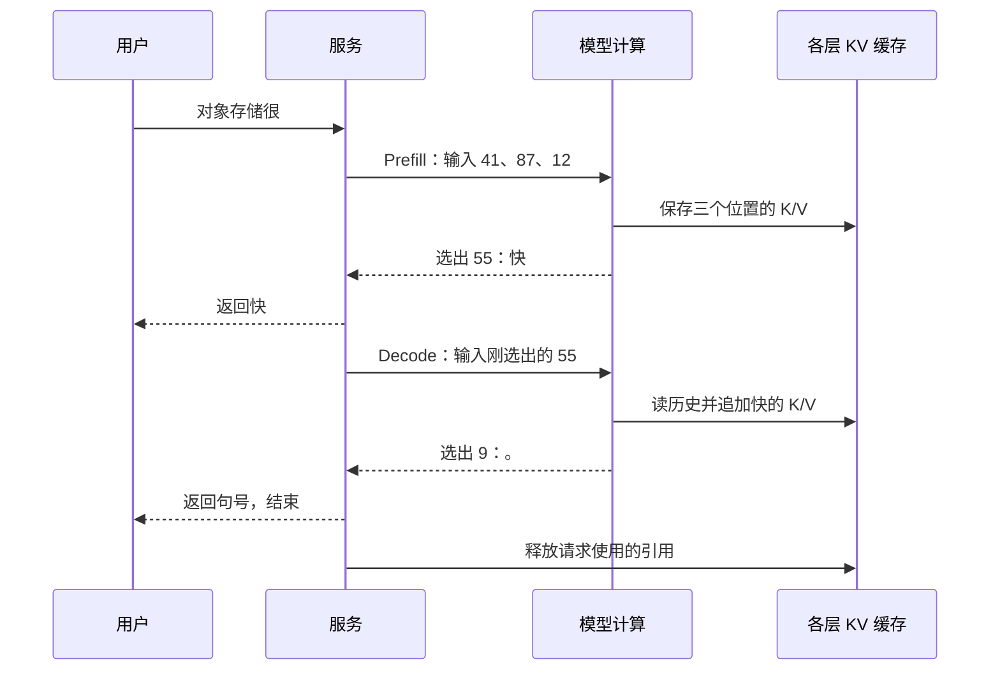

# LLM 前置二：推理与 KV 生命周期

[第一篇]({{ site.baseurl }}/docs/00a_LLM_Model_Transformer/)已经把“对象存储很”变成 `[41,87,12]`，逐层计算后选出编号 55，对应“快”。现在用户希望继续看到完整回答。下一步怎样算？哪些工作会重复？本篇先走时间轴，再引入缓存。

**基础必读：§1～6。** §7 将同样的流程扩展到多请求、共享页和兼容条件，可以第二遍读。这里不要求先学 GPU 编程；先把请求和数组的生命周期讲清楚。

<a id="prompt-context"></a>

## 1. 一次请求到底给模型什么输入

先采用最简单的补句服务：输入就是“对象存储很”。交给模型作为起点的内容叫 **Prompt（输入提示）**。在聊天服务里，实际输入通常更多：服务规定的回答要求、之前的问答，以及用户这次发来的文字，都会被组合进去。

例如服务加上“请用中文回答”这样的系统指令，再放入历史对话，最后加用户问题。这种组合按固定格式标记“谁说的话”，叫**聊天模板（chat template）**。Tokenizer 对组合后的内容编号。因此屏幕上的新问题相同，不保证实际输入 token 序列相同；模板与历史也会影响它。

当前生成可以利用的内容叫 **Context（上下文）**，通常包括输入，以及已经生成并送入模型处理的后续 token。可支持的上下文长度范围叫 **Context Window（上下文窗口）**，通常按 token 数限制。配置 `max_new_tokens` 则限制这次最多生成多少个新 token，两者不是参数量 7B/70B。

如果输入有 6,000 tokens，计划最多输出 2,000，就要为约 8,000 tokens 的过程检查长度约束与内存预算。第三篇会算这个预算。对话历史也不是永远藏在模型参数里的：下一次调用通常仍需带上相关历史，或能复用相应的已计算状态。

<a id="prefill-decode"></a>

## 2. 先走三轮：输出一个片段，下一轮才能处理它

第一篇的一次前向计算，接收已有序列，给下一个 token 候选评分。要不断输出文字，就要重复这个过程。继续使用同一个 Tokenizer：`对象=41，存储=87，很=12，快=55，。=9`。

先假设完全不保留任何中间结果：

| 轮次 | 已知道的序列 | 本轮重新计算的输入 | 选出的下一个 token |
|---|---|---|---|
| 第 1 轮 | 对象 / 存储 / 很 | `[41,87,12]` | 55，“快” |
| 第 2 轮 | 对象 / 存储 / 很 / 快 | `[41,87,12,55]` | 9，“。” |
| 若还继续 | 加上刚选出的“。” | `[41,87,12,55,9]` | 再选下一片段 |

这个“把输出加回已有序列，再预测下一个”的过程叫**自回归生成**。第 1 轮时还不知道会选“快”还是“慢”，所以不能直接把未来回答的所有 token 一起交给模型算。普通生成有这种步骤依赖。

第一次处理整段已知输入的阶段叫 **Prefill（预填充）**。这些输入都已经给定，所以同一层里可以成批计算多个位置，同时用第一篇的因果规则限制它们看哪些位置；下一层仍依赖上一层结果。

首个输出选出后，继续逐步生成后续 token 的阶段叫 **Decode（逐步生成/解码）**。这里的“解码”不是压缩文件解压；在推理服务的讨论中，它通常指这段逐步生成过程。把模型编号还原为文字也是 Tokenizer 的解码操作，二者要看上下文区分。

这条流程可以生成回答，但第 2 轮又重做前三个位置，第三轮还会再重做。输入越长、回答越长，重复计算越明显。接下来才是缓存要解决的问题。

<a id="why-cache"></a>

## 3. 为什么历史 K/V 可以留下，而不必全部重算

看第一层“对象”这一位置：按照因果规则，它只能看自己。后来生成“快”时，它不会突然看到未来内容，因此它已经算出的结果不应改变。“存储”只能看“对象/存储”，“很”只能看前三个位置；追加“快”也不改变它们各自可见的内容。

这个理由对后续层也成立：上一层旧位置结果不变，本层使用相同参数和位置条件，旧位置的 K/V 就可以保持。这里假设普通推理中参数与计算条件不变，没有改写前文。每层都需要保留自己那一套，不能只保存最后一层。

未来“快”自己的 Q 会重新比较所有可见位置的 K，再按得到的比例汇总 V。所以把历史各层的 **K 和 V 留在内存供未来位置读取**，就能少做重复工作；这叫 **KV Cache（键/值状态缓存）**。它缓存的是 attention 数组，不是模型权重，也不是原始文字。[官方缓存机制说明](https://huggingface.co/docs/transformers/main/cache_explanation)用于核对这一数据依赖。

为什么通常不长期保存旧 Q？旧 Q 已经完成旧位置的查询；“快”要用的是新 Q。为什么不能只留旧的 attention 汇总结果？新 Q 的关注比例会变，需要重新匹配旧 K，并汇总旧 V。**缓存避开历史状态的重复构建，但没有消除对历史状态的读取。**

如果把“存储”换成另一片段，就改变了该位置及后续位置的输入条件，不能继续用原来那些后续 K/V。相同片段在不同前文中也不能按编号单独共享一份状态。

<a id="cached-timeline"></a>

## 4. 再走一遍同一请求，这次带上缓存

| 阶段 | 本次实际处理的 token | 处理后各层缓存对应的序列 | 预测并返回 |
|---|---|---|---|
| Prefill | 对象 / 存储 / 很 | `[41,87,12]` | “快”，编号 55 |
| Decode 第 1 步 | 快 | `[41,87,12,55]` | “。”，编号 9 |
| 如果继续生成 | 。 | `[41,87,12,55,9]` | 再选下一片段 |

Decode 只新增当前 token 的状态，但当前 Q 仍读此前的缓存。缓存内容的长度与“屏幕上已经显示了几个 token”不能直接画等号：**刚选出的“快”尚未作为输入做前向计算，因此还没有它自己的 K/V；下一步处理“快”，才把它的状态加入缓存。**

若选出“。”后立即结束，本例输出了两个 token，而缓存只包含 3 个输入 token 加“快”，合计 4 个位置。做最大容量预算时，可保守按 `输入 3 + 最多输出 2 = 5` 个位置留空间，而不依靠一位置的边界差异省容量。



下面是流程伪代码，不是可直接接入某个框架的 API。`state` 存放各层缓存；`scores` 是候选 token 分数；`choose` 按第一篇的规则选择输出：

```python
state, scores = prefill([41, 87, 12], model_weights)
token = choose(scores)  # 本例选出 55
while True:
    emit(token)         # 将编号还原为文字并返回
    if should_stop(token):
        break
    state, scores = decode(token, state, model_weights)
    token = choose(scores)  # 处理 55 后，本例选出 9
release_request_reference(state)
```

保存缓存并没有创建一个新模型版本。所有请求可以使用同一份模型权重，但不同上下文产生不同 state。至于数组占多少字节、放在哪种内存，留给后两篇。

<a id="lifecycle"></a>

## 5. 请求结束后：释放、保留与复用是不同动作

如果不准备复用，请求完成后，可以释放它使用的缓存引用；没有其他读者和仍在执行的操作时，相关内存就能回收。如果预计以后还会遇到相同开头，也可以选择保留一部分。

**Prefix（前缀）**指从序列最开头连续的一段，不是任意相同的词。我们已经算过“对象 / 存储 / 很”。新输入是“对象 / 存储 / 很 / 可靠”，且前三个 token 编号、模型与位置条件都相同，就可能直接复用这三位置的各层 KV。这叫 **Prefix Reuse（前缀复用）**。

<a id="prefix-reuse"></a>

复用后，仍需处理新片段“可靠”。它的 Q 也仍读取此前三位置的 K/V。省的是前缀状态重建，没有省掉后缀计算，也没有让新请求的 attention 不再访问前缀。

“文件存储很可靠”即使后几个片段与前例相同，只要开头不同，一般也不能把它们当作同一个前缀。前缀状态代表整段计算条件，不是“某个词的通用向量字典”。

| 时刻 | 为什么还需要缓存 | 内存能否立即回收 |
|---|---|---|
| 请求正在 Decode | 后续步骤还会读历史 | 不能随意回收 |
| 请求结束，不保留复用 | 本请求不再需要 | 还要检查其他引用和在途操作 |
| 请求结束，留下前缀 | 未来请求可能命中 | 按容量与复用价值决定保留多久 |
| 保留缓存被淘汰 | 让空间供其他状态使用 | 没有活跃使用者后才能回收 |

从缓存中删除低价值状态，通常叫 **Eviction（淘汰）**。下次遇到它就重新算，一般是性能代价，不是删除模型参数或丢失原始输入数据。活跃状态、有其他共享者的状态，以及还有搬运操作在使用的内存，不能仅因某个请求“结束”就立即复用地址。

<a id="metrics"></a>

## 6. 用户看到的两个等待：首片段与后续间隔

用户按下发送到看到“快”的等待，叫 **TTFT（Time To First Token，首 token 延迟）**。它不只包含模型计算，还可能包含排队、准备输入、查找缓存和搬运命中状态。

以一个更长但机制相同的教学请求为例，假设各阶段串行发生：排队 20 ms、准备输入 5 ms、查缓存 2 ms、搬来命中状态 125 ms、剩余输入与首 token 处理 40 ms，共 `20+5+2+125+40=192 ms`。关闭缓存路径时，若完整输入计算花 200 ms，排队和准备仍为 20、5 ms，总共 225 ms。这里比较的是明确给定的耗时，不是从 token 数直接猜出的性能。

“快”到“。”的输出间隔，叫 **ITL（Inter-Token Latency，token 间延迟）**。第一片段很快出现，后面仍可能卡，因为每步还有历史状态读取、计算和调度。

若输出 5 个 token，第 1 个在 200 ms，第 5 个在 280 ms，中间有 4 个间隔，平均为 `(280-200)/4=20 ms`。这种首 token 之后的平均生成耗时常叫 **TPOT（Time Per Output Token）**。`280/5=56 ms` 包含首片段前的等待，是另一个统计口径，不能混用。测试必须说明是否包含排队及如何计数。

主线到这里已闭合：同一模型逐步处理请求，保留各层历史 K/V，缓存随请求增长，结束后按引用和复用策略处理。现在可以进入[第三篇]({{ site.baseurl }}/docs/00c_Tensor_Memory/)算这些数组占多少内存。下面仅在需要理解服务调度和共享边界时阅读。

<a id="batching"></a>

## 7. 进阶选读：多个请求如何共同运行

### 7.1 从两次小运算到一次多行矩阵运算

请求 R1 在接着生成“快”后的内容，R2 在处理另一条句子。可以分别执行两次小矩阵运算，也可以把本轮要处理的向量放成多行，用同一组权重一次计算。把多个请求的工作成组执行，叫 **Batching（合批）**；一组叫 batch，batch size 表示组内请求数量或具体实现所计的工作数量，须说明口径。

它可能增加权重复用、减少反复提交小工作的开销，提高每秒完成的工作量，也就是**吞吐量（throughput）**。但每个不同前文仍需要自己的 KV，合批不会使 R1/R2 的历史自动相同。请求越多，累计状态通常越多；为了等人合批，还可能加重等待。

先组固定批次、等整批结束的方式常叫 static batching。短请求结束后，长请求可能仍继续。若在一轮结束时移出已完成请求、加入新请求，例如第一轮 R1/R2，下一轮 R2/R3，叫 **Continuous Batching（连续合批）**。调度器负责选择每轮运行哪些工作，内存管理也要跟着活跃集合变化。

输入长度不同，会让数组组织更复杂。把短序列补空位置到相同长度，叫 **Padding（填充）**；计算时要用掩码排除这些补位。也可以采用不补齐的打包/分页组织。不能只看 batch size 算容量，要算实际保留了多少 token。

很长输入的一次 Prefill 可能让其他请求等很久。把它拆成多个调度轮次、每次处理一段，叫 **Chunked Prefill（分段预填充）**。后段仍依赖前段上下文，不能当成互不相关的对象块计算。可在原[服务指标与调度]({{ site.baseurl }}/docs/01_AI_Storage_KV_Cache/#chapter-3)继续讨论公平性与速度取舍。

### 7.2 共享内存，不等于允许覆盖历史

两个请求可引用相同前缀的物理内存，再各自增长自己的后缀。如果它们共用一个未满的页，后续写入就不能互相覆盖；可能需要先复制再修改，这叫 **Copy-on-Write（写时复制）**。页是按固定数量 token 分配的一组缓存空间，第三篇会计算它的大小。

异步搬运还会延长 buffer（承载数值的内存区域）的使用时间。只有提交函数返回，不代表搬运已结束。原[物理页共享与回收]({{ site.baseurl }}/docs/01_AI_Storage_KV_Cache/#kv-block-lifecycle)与 GPU 数据路径篇会继续解释这些资源寿命。

### 7.3 完整命中也有边界

如果整个输入都命中，但缓存只存 K/V，没有最终候选分数或最后位置的最终向量，那么单凭 K/V 未必能直接选出下一个 token。执行程序可能另外保留结果，或重新计算最后一个输入位置；重算时必须使用对应前缀并正确更新该位置，不能重复追加一个相同位置。具体缓存接口决定处理方式。

除了相同 token，还要匹配模型版本、位置规则和表示方式。用一小组额外参数改变模型行为的机制常叫 **Adapter**，LoRA 是其中一种做法；改变这些有效参数后，不能默认继续用旧 KV。跨用户共享还要检查授权和隔离。原[兼容契约]({{ site.baseurl }}/docs/03_System_Design_Interview_Demo/#kv-compatibility-contract)会将这些条件分层，那里才进入工程字段与接口。

## 8. 用同一句话检查理解

输入“对象存储很”，连续输出“快”“。”，请区分三件事：选出“快”，处理“快”，保存“快”的 K/V。答案是：Prefill 先选出“快”；下一步 Decode 才处理它、保存其状态并预测句号。若句号后立即结束，本例缓存有四个位置，保守容量预算可留五个。

再问：“缓存命中后为什么仍要读历史？”因为新位置有自己的 Q，需要重新匹配历史 K 并汇总 V。这是持续内存带宽需求的起点，而不仅是某个缓存名词。
