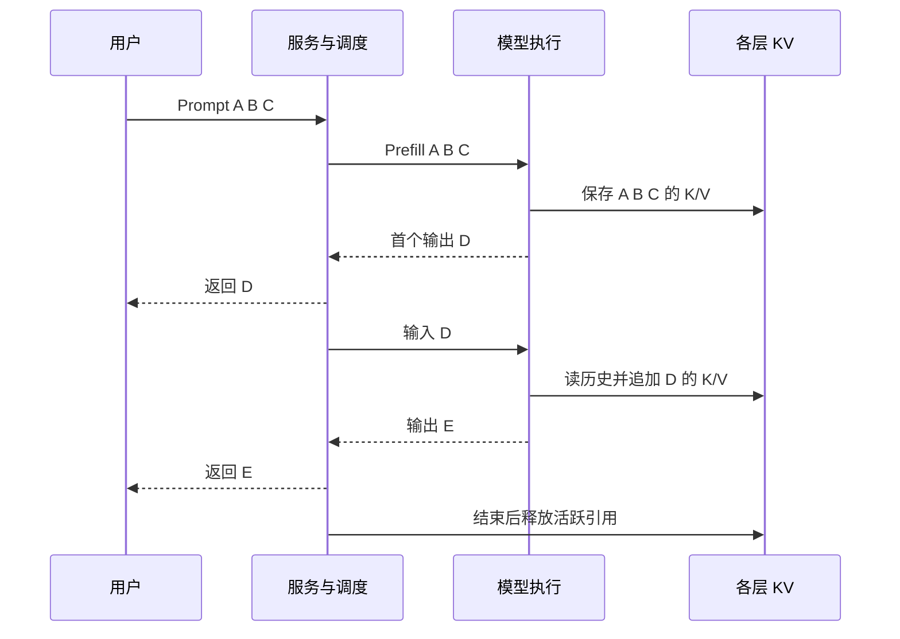

# LLM 前置二：推理与 KV 生命周期

先读[模型与 Transformer]({{ site.baseurl }}/docs/00a_LLM_Model_Transformer/)，本篇把一次前向计算放进真实请求的时间轴。仍以普通自回归生成作为基线，暂不引入 speculative decoding 等变体。

<a id="prompt-context"></a>

## 1. Prompt、Context 和模型版本是三件事

用户问“解释复制失败”，服务可能把 system 指令、历史对话和新问题组合成一个序列，经 chat template 加角色分隔符，再 tokenization。这一实际输入才是 **prompt**。两个屏幕上看起来相同的问题，若 system 指令或模板不同，实际 token 前缀可能不同。

**Context** 是当前计算能使用的上下文，通常包含 prompt 和已生成、已处理的 token。模型的 context window 是支持的上下文长度约束，`max_new_tokens` 是本次输出上限；它们不是模型参数量。若 prompt 6,000 tokens、输出上限 2,000，需确认约 8,000 的总长度与运行配置兼容，并为 KV 增长留余量。

对话历史看起来像永久记忆，但普通服务仍需保留或重新提供相应输入/兼容 KV。重新发送历史文本会重建状态；命中 prefix cache 才可能减少重建，不是模型权重在每轮聊天后发生变化。

<a id="prefill-decode"></a>

## 2. Prefill 与 Decode：用三个输入 Token 走一遍

教学 prompt 是 `[A,B,C]`。模型要预测 D，再预测 E。**Prefill** 批量处理已有输入，**Decode** 逐步处理已经选出的新 token，以得到下一个 token。

| 时刻 | 本次实际输入 | 所有层完成后的 KV 内容 | 本次预测 |
|---|---|---|---|
| Prefill | A、B、C | A、B、C 各层 K/V | 从 C 最终表示预测 D |
| Decode 1 | D，带已有 KV | A、B、C、D 各层 K/V | 预测 E |
| Decode 2 | E，带已有 KV | A、B、C、D、E 各层 K/V | 预测 F |

**刚采样出的 D 还没有跑过自己的前向，因此还没有 D 的 KV。** 如果生成 D 后立即结束，KV 长度仍可为 3；工程容量预算用 `prompt + max_new_tokens` 是保守上界，不必为一 token 的边界差异少留空间。

Prefill 可以在一层内同时算多个位置的 Q/K/V 和矩阵乘法，因为输入 A、B、C 全部已知；因果 mask 保证 B 不看 C，C 可以看 A/B。它仍要按层顺序执行。Decode 的 E 还没被选出来，无法提前像已知 prompt 一样一起处理 D/E/F，这就是自回归的串行依赖。



伪代码可以用熟悉的状态对象理解，实际 kernel 和缓存布局另论：

```python
state, logits = prefill(prompt_ids, weights)
token = choose(logits[-1])
while True:
    emit(token)
    if should_stop(token):
        break
    # 本轮处理刚输出的 token，才把它的 KV 放入 state
    state, logits = decode(token, state, weights)
    token = choose(logits)
release_active_reference(state)
```

state 不是权重副本；每层有自己的 K/V。没有缓存时，可把 `prompt + 已生成序列` 每轮整体前向，结果在相同条件下可以对应同样的下一 token 分布，但重复处理历史更贵。有缓存后，只新增当前 token 的各层状态，仍读历史 KV。

<a id="batching"></a>

## 3. Batching 为什么提升吞吐，却加重显存压力

想象两个请求 R1、R2 都在 Decode。单独执行会分别调用许多小运算；合批可把两个新 token 的表示组成多行矩阵，让同一份权重服务更多输入，减少调度开销并增加复用。但 R1/R2 的历史不同，各自读取自己的 KV，不能因为共享权重就共享全部状态。

**Static batching** 先组成固定批次，短请求完成后其位置可能闲置，长请求仍运行。**Continuous batching** 在迭代边界让完成请求退出、新请求加入。比如第 1 轮 R1/R2，R1 结束；第 2 轮 R2/R3。它改变活跃集合，因此需要动态分配与回收 KV，并控制每轮 token budget。

各序列长度不同，实际引擎可以使用 padding/mask 或打包、分页等机制。一个逻辑 batch 不一定是规整的 `[B,T]` 物理数组，容量应按实际保留 token 求和，而不是只看 batch size。R2 有 8,192 tokens、R3 有 512 tokens，不能假定二者各占 512 tokens 的 KV。

长 prompt Prefill 可能占 GPU 很久，影响已在 Decode 的请求。Chunked prefill 把其工作分多轮，与 Decode 交错，但下一 chunk 仍依赖之前上下文；它不是独立无状态的文件块计算。既有主教程[服务指标与调度]({{ site.baseurl }}/docs/01_AI_Storage_KV_Cache/#chapter-3)进一步讨论吞吐与延迟取舍。

<a id="lifecycle"></a>

## 4. 活跃 KV、可复用 KV 与回收

| 阶段 | 谁还会读这些状态 | 可以怎样处理 |
|---|---|---|
| Prefill 产生 | 本请求后续层/Decode | 保留并建立正确位置映射 |
| 活跃 Decode | 后续每轮 attention | 保持可访问；不能随意删除 |
| 请求结束 | 本请求不再继续，可能还有共享引用 | 释放请求引用，检查其他使用者 |
| 缓存保留 | 未来兼容前缀可能复用 | 按收益、容量、隔离和 TTL 管理 |
| Evict | 没有活跃读者，也无在途搬运 | 可回收；未来 miss 时重算 |

请求结束不一定立即释放所有物理页，因为其他请求或 prefix cache 仍持有引用；反过来，保留每次聊天的全部 KV 也会很快占满显存。丢弃可重算 KV 通常导致下次更慢，不等于丢失权重或训练数据。

若 A 的前缀在多个请求间共享，新增后缀不能覆盖共享页；需要新页或 copy-on-write。若有异步 offload/restore，网络/GPU 操作尚未结束也不能提前复用 buffer。这是熟悉的引用与在途任务寿命问题，只是消费者变成了 attention kernel，详见[物理页共享与回收]({{ site.baseurl }}/docs/01_AI_Storage_KV_Cache/#kv-block-lifecycle)。

<a id="prefix-reuse"></a>

## 5. Prefix Reuse 到底跳过了什么

假设新 prompt 为 `[A,B,C,X,Y]`，兼容缓存已有 A/B/C 的各层 KV。引擎可恢复前三个位置，继续处理 X/Y。Y 预测第一个新输出；X/Y 的 Q 仍会访问已恢复的 A/B/C KV。节省的是前三个位置的状态重建，**没有消除它们在 attention 中的读取，也没有免除后缀计算**。

如果整个 prompt 全部命中，但缓存仅保存 K/V，没有最后位置的 logits/hidden state，那么单凭这些 bytes 未必能直接得到下一个 token 分布。引擎可能保留其他结果，或让最后一个输入 token 再前向一次；取决于缓存协议。不能把“KV 完整命中”说成“完全零模型计算”。

相同后半段文本、不同开头，一般不是相同 prefix。复用 key 应结合模型权重 revision、LoRA/adapter、token 序列、位置与必要表示契约，还要控制租户隔离。更完整的工程验证见[Compatibility Contract]({{ site.baseurl }}/docs/03_System_Design_Interview_Demo/#kv-compatibility-contract)。

<a id="metrics"></a>

## 6. 用户看到的延迟从哪里来

**TTFT** 是请求进入服务到首个输出 token 的时间。假设排队 20 ms，准备输入 5 ms，prefix lookup 2 ms，restore 125 ms，剩余 prefill 与首 token 处理 40 ms；本教学串行路径共 192 ms。若没有缓存、同样排队和准备而完整 prefill 200 ms，则约 225 ms。命中并没有省掉全部 200 ms，恢复本身也花时间。

**ITL** 是相邻输出间隔，**TPOT** 常用首 token 之后的平均生成耗时。若第 1 个输出在 200 ms、第 5 个在 280 ms，后四个间隔平均 `80/4=20 ms`；不能把 `280/5=56 ms` 当作同一个指标。定义与计时边界必须随 benchmark 写清。

首 token 快而后续卡顿，可能是活跃 KV 搬运、HBM 带宽、调度或通信瓶颈；启动加载权重慢则是另一条存储路径。传统 GET latency 不足以代表用户体验，要把请求等待关联到模型阶段。

## 7. 面试自检：沿请求而不是沿名词回答

给出 prompt 4 tokens、输出 2 tokens：普通流程先保存 4 个位置的 KV，预测输出 1；随后处理输出 1，保存第 5 个位置 KV，预测输出 2。保守预算留 6 tokens。停止后先释放活跃引用，再判断是否有共享读者、缓存保留或在途 I/O。

再解释 batch 从 2 增到 8 的利与弊：权重复用和吞吐可能改善，但累计 KV 增长、排队和单轮时间可能伤害 TTFT/ITL。只有明确当前瓶颈和 SLO 后，才知道是否值得。

接下来读[Tensor 与显存计算]({{ site.baseurl }}/docs/00c_Tensor_Memory/)，把这些状态变成 bytes。
