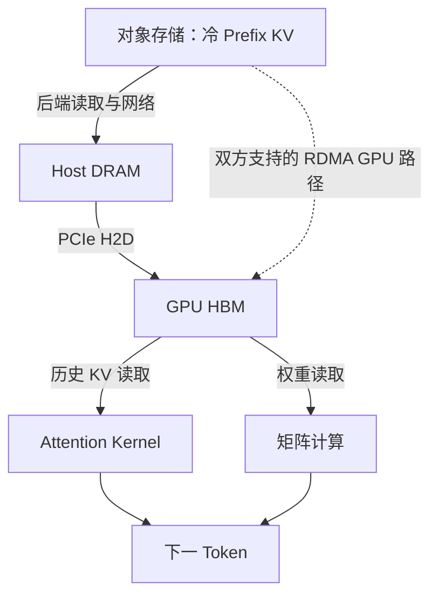

# LLM 前置四：GPU 推理如何产生存储需求

[显存篇]({{ site.baseurl }}/docs/00c_Tensor_Memory/)得到 1 GiB 冷 prefix，本篇解释为何还要问：它在哪里、搬来要多久、会阻塞哪个推理阶段？本篇只建立机制与性能模型，CUDA、RDMA、GDS、cuObject 的具体路径继续由原有第二篇负责。

## 1. GPU、HBM 与 CUDA Kernel 各做什么

CPU 适合执行复杂控制流和多种任务。GPU 有大量并行执行资源，适合把矩阵乘法等相同模式的计算分配给许多线程。CPU 上的推理引擎安排工作，GPU 执行计算；不能因使用 GPU 就把 CPU、内存分配和网络控制从架构中删除。

**CUDA kernel** 是提交到 GPU 执行的程序，由许多线程协作处理数组。一次生成不是一个神奇的“模型 kernel”，而是一系列矩阵乘法、attention、归一化、采样等运算；框架可能融合多个操作。Tensor Core 是部分 GPU 上用于加速矩阵乘累加的硬件执行单元，不是保存 KV 的存储层。具体指令和 dtype 支持取决于硬件。

**HBM** 是部分 GPU 使用的高带宽设备内存（另一些 GPU 使用 GDDR 等内存），保存常驻权重、活跃 KV、临时数组和工作区；寄存器、片上 shared memory、cache 更小更靠近计算资源，不能把它们容量当成 HBM。服务器 DRAM 则通常是 host memory。模型能在 CPU 上运行，GPU 是加速选择，不是“模型”定义的一部分。

教学离散 GPU 通过 PCIe 与 host/设备连接；GPU 间还可能有其他高速互连。HBM 带宽描述 GPU 读写本地内存的能力，PCIe 带宽描述跨总线搬运，网络带宽描述节点间传输。三者即使都用 GB/s，也不是可以互相替换的性能指标。

## 2. 同一块 KV 穿过哪些带宽域

实线是 S3→host→GPU 基线；虚线表示需完整支持和验证的替代路径，不是普通 GET 自动获得的能力。冷块进入 HBM 后，后续 decode 仍从 HBM 读它。NIC 把 bytes 写到 GPU 并不能代替 attention，也不能自动证明数据格式、完整性和 GPU consumer 可见性。

Pinned memory 是 page-locked host memory，适合受支持的 DMA/异步复制路径；它本身没有变成 HBM，也没有自动启用 GDS 或 GPUDirect RDMA。GDS/cuFile 面向受支持的存储/文件路径；GPUDirect RDMA 面向设备间远端搬运；cuObject 提供对象控制语义与其 RDMA 数据路径。它们的边界在[原第二篇 §6～7]({{ site.baseurl }}/docs/02_GPU_Data_Path/#chapter-6)继续解释，不在本轮重复 API 教程。

## 3. 计算吞吐量与内存带宽：为什么一个“快”字不够

FLOP 是一次浮点运算；FLOP/s 衡量每秒可执行多少。按一次乘法加一次加法计 2 FLOPs，矩阵 `[m,k]×[k,n]` 约需要 `2mkn` FLOPs。带宽 bytes/s 衡量搬运多少字节。GPU 算力高但数据没到，也会等待。

一个简化瓶颈下界是：

$$
t\geq\max\left(\frac{F}{C},\frac{S}{B}\right)
$$

F 是本次操作 FLOPs，C 是有效 FLOP/s；S 是所分析瓶颈内存接口的 bytes，B 是其有效 bytes/s。max 表示两种约束都必须满足，并假设存在足够重叠；没有重叠或有调度/通信开销，实际时间更大。不能把网络 bytes 填入 HBM B，再宣称得到整个模型执行时间。

假设一次投影用 FP16 权重 `[4096,4096]`，权重 32 MiB。一个输入行的乘法约 `2×4096×4096=33,554,432 FLOPs`；若必须从 HBM 读取整份权重、暂忽略输入输出，算术强度 `F/S≈1 FLOP/byte`。把 128 行合批，同一权重理想只读一次则约 `128 FLOPs/byte`，计输入输出后略低。**算术强度**就是一次接口搬运的每 byte 带来多少计算（矩阵 FLOPs 与复用模型可核对 [NVIDIA Matrix Multiplication](https://docs.nvidia.com/deeplearning/performance/dl-performance-matrix-multiplication/index.html)），可解释为何 batching 增强权重复用。

假设教学 GPU 有有效 `100 TFLOP/s=10^14 FLOP/s` 和 `1 TB/s=10^12 bytes/s`，比例为 100 FLOPs/byte。上面的 1 远低于 100，倾向受内存带宽约束；128 接近/高于该比例，但真实 tiling/cache/调度仍须验证。数值不代表具体 GPU。

Prefill 通常有许多已知 token 可形成大矩阵；小 batch decode 通常每序列只有一个新 token，并扫描历史 KV，因此常偏带宽。大 batch、长上下文、attention kernel 和跨卡通信都会改变瓶颈。[NVIDIA 性能指南](https://docs.nvidia.com/deeplearning/performance/dl-performance-gpu-background/index.html)用于核对计算/内存/延迟限制；不是“Prefill 永远 compute-bound”的保证。

## 4. AI 机制怎样变成三类存储需求

权重需要加载，是“服务进程获得模型”的路径；训练样本和 checkpoint 是“学习/恢复训练”的路径；KV 是“已计算的输入状态是否保留”的路径。先分清对象是谁，再谈 S3。

对 KV 又分三种场景：

| 场景 | 数据为什么要移动 | 用户等待什么 | 不能照搬的结论 |
|---|---|---|---|
| 活跃 Decode | HBM 容量受限或状态分层 | 后续每轮 attention 可访问 | 不能默认逐 token 从 S3 冷层取历史 |
| Prefill→Decode 交接 | 两个 worker 分担阶段 | Decode 收到本次 prompt 状态 | 即时交接不默认绕对象持久化 |
| 冷 Prefix 复用 | 请求结束后仍可能再次命中 | 兼容 KV 恢复到可计算状态 | 存得下不等于恢复比重算快 |

**Offload** 是把状态从原位置移到另一层；它可能释放 HBM，但消耗 host/网络/PCIe 并增加等待。**Prefix reuse** 是复用兼容状态减少计算；命中在同机 HBM 时可能不必搬运，在对象层时要先 restore。二者可以组合，但不能当同义词。

为什么不直接保存文本？文本或 token ID 很小，却只是重算输入。KV 大得多，但包含逐层计算结果。假设 tokenizer 输出 ID 用 int32，本例 8,192 tokens 的 ID 约 `8192×4=32 KiB`，KV 却有 1 GiB。存储工程的选择是用更多容量/流量换 GPU 重算时间，而不是让所有输入都永久复制到对象层。

## 5. Restore vs Recompute：从字节推到临界带宽

仍取 `L=32,Hkv=8,D=128,FP16` 的 8,192-token prefix，裸 KV S=1 GiB。假设有效存储→GPU-ready payload 瓶颈带宽 Beff 为 8 GiB/s，目录与固定准备耗时 Tfixed=10 ms，校验/布局/可见性等串行剩余成本 Textra=15 ms。这个教学模型暂不重叠各项：

$$
T_{restore}=T_{fixed}+\frac{S}{B_{eff}}+T_{extra}
=10+125+15=150\;ms
$$

假设在同样服务条件下，重建这段 prefix 的有效耗时 Trecompute=200 ms，则恢复这一步省约 50 ms。后缀 prefill、排队与输出流程未必省掉。现实里两条策略还会改变其他请求的 GPU/网络排队，须用相同负载和计时边界比较。

临界带宽不是凭经验喊一个值，而是求 `Trestore<Trecompute`：

$$
B_{eff}>\frac{S}{T_{recompute}-T_{fixed}-T_{extra}}
=\frac{1\;GiB}{0.200-0.010-0.015\;s}
\approx5.71\;GiB/s
$$

分母若非正，即使搬运无限快，固定与其他成本也已不优于重算；不存在这套模型下的有限正交点。在 4 GiB/s 时恢复约 `10+250+15=275 ms`，应倾向重算或改策略，而不是因“命中”强行 load。

Beff 必须覆盖所选路径的真正瓶颈。若分别已测网络加载与 H2D、布局时间，可分项计算；若 Beff 是全程 GPU-ready 的 bytes/elapsed，不能再重复加已包含的 H2D。缓存写入成本、未来命中概率、容量与租户隔离也影响是否保存，详细策略接[主教程的临界判断]({{ site.baseurl }}/docs/01_AI_Storage_KV_Cache/#kv-restore-recompute-budget)。现有 Demo A 是决策计算模型，本轮不改其工程实现，也不把此例视作 GPU benchmark。

## 6. 从链路速率到页面可用时间

网络 100 Gbps 是 `100×10^9 bits/s`，除 8 得 12.5 GB/s 的理论 byte rate。传 1 GiB 的纯 payload 下界 `1,073,741,824/12.5×10^9≈85.9 ms`，不是 10 ms。协议、争用、后端读取、EC、注册、调度和 GPU 布局会让 ready 更晚。

64 MiB 块同理为约 5.37 ms；64 **MB** 块才是 5.12 ms。16 个 64 MiB 共 1 GiB，不能把十进制/二进制算例混用。

若教学有效网络→host 为 8 GiB/s、host→GPU 为 16 GiB/s，完整 1 GiB 串行需要 `125+62.5=187.5 ms`，还没加其他成本。若以 64 MiB 双缓冲流水、每段内依次加载再复制，理想加载每块 7.8125 ms、复制每块 3.90625 ms；阶段可充分重叠时，16 块约 `7.8125+15×7.8125+3.90625=128.90625 ms`。实际重叠受 pinned buffer、异步顺序与资源争用影响，不保证等于理想值。

流水不能突破最慢阶段的持续吞吐。假设平均每秒 20 次独立冷命中，每次 1 GiB，则长期需求 20 GiB/s，单路径有效 8 GiB/s 会排队，不会因双缓冲消失。平均负载已饱和时 p99 更难保证，需限流、分流、重新算或降低外层命中搬运需求。网络/GPU-direct 优化还不能消除后端物理读取量与 EC read amplification。

## 7. 从已有存储经验进入主教程

你已经熟悉复制完整性、在线/后台隔离、重试和元数据状态。新的部分是：bytes 的消费者需要特定 KV layout 与模型身份，恢复收益取决于 GPU 重算成本，且活跃 Decode 有持续读取与输出延迟约束。

完成四篇后，先进入[AI Storage 与 KV Cache]({{ site.baseurl }}/docs/01_AI_Storage_KV_Cache/#chapter-3)，继续容量增长、分页和 offload 判断；再进入[GPU Data Path]({{ site.baseurl }}/docs/02_GPU_Data_Path/#chapter-1)，把本篇的带宽域落实为 buffer、CUDA、RDMA 和完成条件；最后沿[冷 Prefix 系统设计]({{ site.baseurl }}/docs/03_System_Design_Interview_Demo/#kv-cold-prefix-request)走到 GPU Ready。

## 8. 前置毕业题：不依赖名词背诵

遮住前文，用一个完整回答连接六件事：模型权重是什么；输入如何经各层得到 Q/K/V；为什么 Prefill 后能单 token Decode；每 token 为何有 128 KiB KV；1 GiB 命中要在何种带宽下胜过 200 ms 重算；搬运完成为什么还不能直接发布 ready。

参考骨架：权重是共享的数值变换参数；token 经 embedding 与逐层 attention 产生输入相关状态，因果条件使旧 KV 可保留；新 token 仍用新 Q 读历史。每层每 head 保存 K/V 两组 128 元素 FP16，乘 8 heads 与 32 层得 128 KiB/token；8,192 tokens 得 1 GiB。按本例成本临界带宽约 5.71 GiB/s；完整性、兼容布局与设备可见性闭合后，才可让 consumer 使用。

若某一环说不清，只回到对应前置篇，不新增专题。四篇是现有知识库的补课入口；仓库继续维护模式，后续以闭卷算题、运行现有实验与投递反馈为主。
