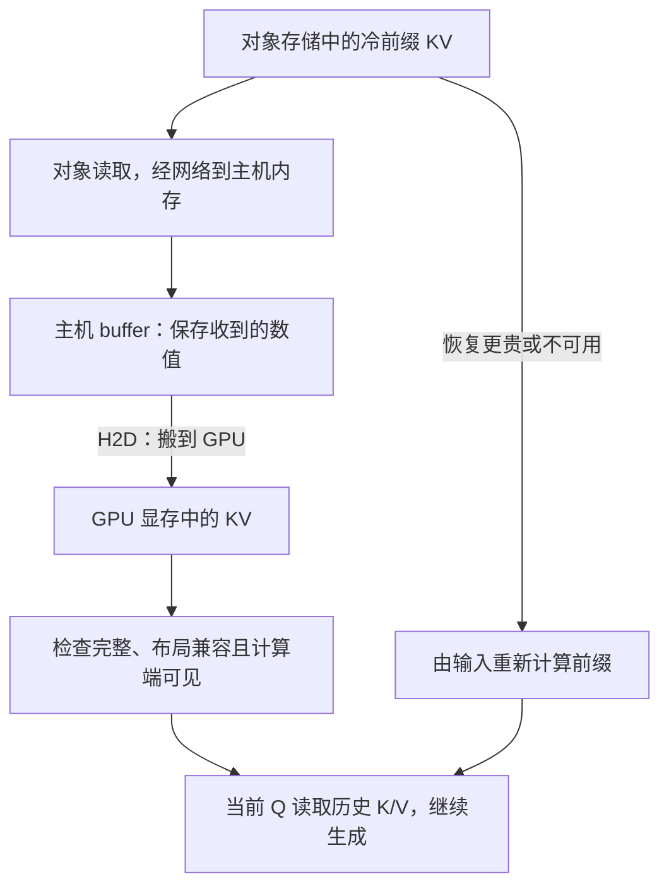

# LLM 前置四：GPU 推理如何产生存储需求

前三篇解释了“对象存储很”怎样生成“快”“。”，为何每一步还要读历史 K/V，以及状态怎样变成字节。现在把输入扩成一段很长的文档：机制相同，只是计算更多、KV 更大。我们要解决三个工程问题：在哪儿算，状态放哪儿，以及放不下或再次命中时怎样处理。

**基础必读：§1～7。** §8 是进阶选读，保留计算/带宽模型、流水推导及 GPU 直达路径的机制边界。第一遍不需要记 CUDA API 或硬件型号，全部数字仍是教学假设。

<a id="gpu-hbm"></a>

## 1. 为什么把模型计算交给 GPU

第一篇的一个输出坐标要做一串乘加；真实模型同时对许多坐标、位置和层重复这样的运算。普通 **CPU（中央处理器）**可以执行这些计算，也擅长服务请求处理、判断分支、管理文件和网络等工作。**GPU（图形处理器）**则有大量适合并行数值计算的执行资源，能让许多相似工作同时推进，因此常被用来加速模型。

不是“模型有了 GPU 才是 AI”，而是执行位置影响速度与内存路径。典型服务由 CPU 上的程序接请求、分配资源、安排工作，再把大批数值计算提交到 GPU；CPU 并没有从系统中消失。

提交到 GPU 执行的一段计算程序通常叫 **Kernel（计算核程序）**。它和操作系统内核不是同一个概念。一个 kernel 可以安排许多执行线程，各自或协作处理数组的不同部分。**CUDA**是 NVIDIA GPU 的编程平台；在这套平台上执行的 GPU 程序可称为 CUDA kernel。

一次模型前向可能包含许多 kernel：有的做矩阵乘法，有的做 attention，有的调整数值或选择输出。实现也可以把多个操作合并成一个程序，减少提交与临时数组，这叫融合。现在不需要编写这些程序，只要知道“完成一次模型调用”并不等于“执行一个特殊的 AI 指令”。

## 2. GPU 的数组放在哪里：本地内存与搬运通道

GPU 需要能读到权重、KV 和临时中间结果。GPU 附近供其访问的设备内存，就是第三篇的显存。部分 GPU 使用 **HBM（High Bandwidth Memory，高带宽内存）**这种技术，另一些使用不同内存技术；不能说所有显存都叫 HBM。

CPU 通常主要访问服务器系统内存。它常采用 **DRAM（动态随机访问内存）**技术，也常称为 **Host Memory（主机内存）**。这里 host 指承载 CPU 与服务程序的主机一侧，device 指 GPU 等设备一侧。HBM 与主机 DRAM 都保存 bytes，但在 GPU 与 CPU 有各自内存的典型服务器中，不能把一段主机内存默认当成已经位于 GPU 本地的 KV。

**PCIe**是连接 CPU、GPU、网卡、NVMe 等设备的一种互连。它像数据要经过的通道，不是又一个保存模型的缓存层。GPU 从主机接收数组时，常见方向叫 **H2D（Host to Device）**；反方向叫 D2H。具体平台还有其他互连，不能仅凭一张 GPU 的内存规格猜出主机搬运速度。

还要区分容量与带宽：容量说“能放多少 bytes”；带宽说“每秒能搬多少 bytes”。显存足够，不代表每轮读取足够快；GPU 本地带宽高，也不代表网络数据能以同样速度到达。

<a id="compute-bandwidth"></a>

## 3. 同一个生成过程，为什么有时等计算、有时等读取

Prefill 时，输入中的许多位置都已经给定，可以把它们的向量排成多行矩阵，一次使用同一组参数处理。Decode 时，每个请求通常只有一个刚选出的新 token，但仍需用权重计算，并用新 Q 访问全部可见历史 K/V。

所以，长输入一次处理与小批量逐步输出，可能有不同瓶颈：前者有较多可并行运算，后者每步新增工作较小，但不能省掉历史读取。多个请求合批可以改善权重复用，却增加累计 KV 和调度负担。

工程中把“等待计算执行资源”叫计算受限，把“等待数据通过内存接口”叫带宽受限。这些是需要验证的工作区间，不是“Prefill 永远算力受限、Decode 永远带宽受限”的规则。§8.1 用数字说明如何判断。

这里已经能看出存储工程的新增约束：历史 KV 在每步生成中仍要被读取。它不只是一个生成前 GET 一次、之后永远不再访问的文件。

<a id="storage-workloads"></a>

## 4. 放不下的状态，搬出去以后还要付什么代价

第三篇中，六个请求输入时约占 6 GiB KV，但连同最大输出预算需要 7.5 GiB，超过可用空间。一个办法是减少同时处理的请求或限制输出；另一个办法是把部分状态放到主机内存或远端缓存，需要时再取回。这种把状态从原位置外移的动作叫 **Offload（卸载/外移）**。

它能减少某一时刻的显存占用，但后续 attention 仍需要那些状态，因此可能增加主机读取、总线或网络搬运等待。省容量与省延迟不是同一个目标。第二篇的 Prefix Reuse 又是另一件事：它复用已经算出的兼容前缀，减少重算；只有命中状态不在当前消费位置时，才还需要搬运。

先按“数据为什么要用”区分三种 KV 场景：

| 场景 | 数据移动的原因 | 应关心的等待 |
|---|---|---|
| 活跃请求持续 Decode | 还要生成后续 token，历史状态不能随意丢 | 每步使用历史 KV 时的等待 |
| Prefill 与 Decode 分给不同工作进程 | 负责后续生成的进程需要输入阶段已算出的 KV | 两个阶段交接的等待 |
| 请求结束后的冷前缀复用 | 相同前缀以后可能再次出现 | 命中后恢复状态，是否比重新计算更快 |

**冷**在这里指不在当前 GPU 的活跃工作集中、可能较少或较晚再次访问的状态，不是温度。它可以保存在主机、远端缓存，或选入对象存储，不能从“冷”直接推导一个固定位置。

对象存储还承担其他 AI 数据：训练读取样本、保存检查点，推理服务启动时加载模型权重。它们的生命周期与读写节奏不同。训练通信、活跃 KV 读取、权重冷启动、冷前缀恢复，不能都当成同一类 S3 流量。

<a id="gpu-paths"></a>

## 5. 跟踪一个冷前缀：从对象到能够计算

对象存储工程师熟悉的基线路径是：先读取对象，通过网络进入主机内存，再复制到 GPU 显存。假设我们保存了一段与新请求开头相同的 KV，新请求想复用它，就要让后续 attention 能在正确位置读到这些数组。



**Buffer**是承载数据的一块内存区域；**Layout（布局）**描述 K/V 元素、轴、页与偏移怎样组织。对象内容完整，不代表它的数组组织正好适合目标计算程序；可能需要转换。搬运提交返回也不代表操作已完成，而搬运完成后仍要满足计算端能按顺序看到数据的条件。

这些条件满足，才能说该状态 **GPU Ready（GPU 计算可用）**。它不是某个硬件寄存器名称，而是本教程设计中“允许消费者使用”的状态。重试、超时和 buffer 回收，要确保旧操作不会在内存被复用后继续写入。

如果只保存输入文本或 token ID，内容小很多，但仍须从头做前缀计算。假设用 int32 保存每个 token 编号，32 bits=4 bytes，8,192 个编号约占 `8192×4=32 KiB`；第三篇同长度的教学 KV 是 1 GiB。**保存 KV 是拿更多容量和流量换掉部分计算，不是同样内容换个文件名。**

<a id="restore-recompute"></a>

## 6. 是搬回状态，还是重算：先算一次，再写公式

继续第三篇统一配置：32 层、8 套 K/V、每向量 128 元素、FP16，8,192-token 前缀的 KV 为 1 GiB。这些尺寸决定 bytes；重新算它要多久，还取决于设备与负载，不能只凭 bytes 推断。

**Restore（恢复）**在这里指把保存的 KV 搬回并变成可计算状态；**Recompute（重算）**指用原输入和模型重新建立 KV。它们不是“读取更可靠”与“计算不可靠”的比较，而是两条获得同样可用状态的路径。

先用最简单的除法：若搬 64 bytes，每秒能搬 8 bytes，搬运耗时至少 8 秒。把量放大：有效搬运带宽 8 GiB/s，数据 1 GiB，纯搬运需 `1/8 s=0.125 s=125 ms`。这里 1 秒是 1,000 毫秒。

再假设查目录与准备共 10 ms，校验、布局转换与可见性等额外串行工作共 15 ms，恢复总时间是 `10+125+15=150 ms`。若相同负载下重新计算前缀需 200 ms，本例恢复这一步省 50 ms；剩余输入的计算和后续 Decode 并不会全部消失。

现在定义符号：S 是 KV payload 大小，以 GiB 计；B_eff 是有效搬运带宽，以 GiB/s 计；T_fixed、T_extra 分别是准备与其他成本，以秒计。恢复时间 T_restore 为：

$$
T_{restore}=T_{fixed}+\frac{S}{B_{eff}}+T_{extra}
=0.010+\frac{1}{8}+0.015=0.150\;s
$$

这是先算三项再相加的教学模型，暂不重叠它们。B_eff 若是整个“从查目录到 GPU Ready”的端到端 bytes/时间，不能再把它已包含的成本重复加一遍；若分阶段测量，则按真实路径分别算。测量口径必须一致。

带宽降到 4 GiB/s 时，搬运变成 250 ms，加固定与其他成本共 275 ms，已经慢于 200 ms 重算。**命中对象缓存不是必须读取的命令，仍要判断恢复有没有净收益。**

临界值怎么来？重算有 200 ms，扣掉恢复必付的 `10+15=25 ms`，搬运最多只能用 175 ms，即 0.175 秒。要在这段时间搬完 1 GiB，带宽必须大于 `1/0.175≈5.71 GiB/s`。用不等式写成：

$$
B_{eff}>\frac{S}{T_{recompute}-T_{fixed}-T_{extra}}
=\frac{1\;GiB}{0.200-0.010-0.015\;s}
\approx5.71\;GiB/s
$$

若固定与其他成本已经不少于重算时间，分母非正，这套模型就没有有限正交点：就算搬运很快，也赢不回其他成本。是否保存还受未来命中概率、写入代价、容量与隔离影响；原[恢复与重算预算]({{ site.baseurl }}/docs/01_AI_Storage_KV_Cache/#kv-restore-recompute-budget)继续展开。现有 Demo A 是计算决策模型，不是这些时间已在 GPU 上实测。

<a id="network-budget"></a>

## 7. 网络很快，为什么仍不能代替 GPU 本地内存

网络常用 Gbps，表示每秒十亿个 bit；容量用 bytes。100 Gbps 除以每 byte 的 8 bits，理论上是 12.5 GB/s。1 GiB=`1,073,741,824 bytes`，因此纯 payload 时间下界为：

```text
1,073,741,824 bytes ÷ 12,500,000,000 bytes/s
≈ 0.0859 s = 85.9 ms
```

这还没算对象请求、后端读取、排队、布局转换等。**理论速率**是链路规格与单位换算；**有效速率**是特定负载下实际获得的 payload/时间。两者不能直接互换。GPU 本地 HBM 带宽也只描述其本地接口，不代表网络或 PCIe 能达到相同速度。

每秒平均 20 次独立冷命中、每次搬 1 GiB，长期需求就是 20 GiB/s。如果共享路径只能提供 8 GiB/s，任务会积压；并发提交更多不会让容量守恒失效。你熟悉的流量隔离、限流与故障恢复，到了这里要与首 token 延迟和后续生成间隔一起评估。

下一阶段会看到 **RDMA（Remote Direct Memory Access，远端直接内存访问）**：在受支持的设备与软件路径中，设备能把数据传到已准备好的内存区域，减少一些传统 CPU 搬运工作。它没有把网络变成 HBM，也没有自动处理 S3 对象定位、鉴权、完整性或提交语义。

因此 **S3 over RDMA** 的讨论要分开两件事：对象 API 的控制请求与语义，以及 payload 采用怎样的传输路径。普通 S3 GET 不能默认就是一个 RDMA READ 操作，也不能默认任意对象服务可以直接写 GPU。原[GPU Data Path]({{ site.baseurl }}/docs/02_GPU_Data_Path/#chapter-1)会接着讲具体资源、buffer 寿命和完成顺序。

读到这里，四篇基础主线已完成：模型需要数组计算，逐步生成产生输入相关 KV，长上下文与并发消耗内存，外移或复用又产生搬运和性能约束。下面是进一步做数量级判断与理解硬件路径的选读。

## 8. 进阶选读：更精确的性能与数据路径模型

### 8.1 计算量、算术强度与瓶颈下界

把一次浮点乘法或加法记为一个 **FLOP**；FLOP/s 是每秒可执行多少这类运算。TFLOP/s 的 T 表示 `10¹²`。按一乘一加计 2 FLOPs，`[m,k]×[k,n]` 约需 `2mkn` FLOPs：m×n 个输出，每个要累加 k 个乘积。边界上的一次加法差异在大矩阵估算中忽略。

设 F 是本次运算 FLOPs，C 是有效 FLOP/s；S 是所分析内存接口的字节流量，B 是其有效 bytes/s。完成时间至少同时满足计算与数据要求：

$$
t\geq\max\left(\frac{F}{C},\frac{S}{B}\right)
$$

max 是取两者较大值，两项都得到秒。这只是下界；重叠不足、提交、依赖与通信可让时间更长。网络 bytes 不能填入 HBM 带宽再当成全路径结果。

教学 FP16 权重矩阵 `[4096,4096]` 占 `4096×4096×2=32 MiB`。一个输入行约做 `2×4096×4096=33,554,432 FLOPs`。若整份权重从 HBM 读取一次、暂不计其他流量，则每搬一个 byte 只做约 1 FLOP。这个比值 F/S，叫**算术强度（arithmetic intensity）**。

若 128 行合批、整份权重理想只读一次，约有 128 FLOPs/byte；算上输入输出则略低。假设有效算力为 100 TFLOP/s，HBM 带宽 1 TB/s（十进制 `10¹² bytes/s`），比值是 100 FLOPs/byte。强度 1 明显偏低，倾向等内存；强度 128 接近/超过设备比值，但仍要验证实际实现、片上复用与调度。数字不代表某个 GPU。

部分 GPU 有 **Tensor Core**，即加速矩阵乘累加的硬件单元，不是保存 Tensor 的另一层内存；具体类型支持取决于硬件。[NVIDIA GPU Performance](https://docs.nvidia.com/deeplearning/performance/dl-performance-gpu-background/index.html)与[矩阵乘法指南](https://docs.nvidia.com/deeplearning/performance/dl-performance-matrix-multiplication/index.html)用于核对这些性能机制，不提供本例的实测。

### 8.2 两段搬运可以怎样流水，却不能突破最慢阶段

若对象→主机有效带宽 8 GiB/s、主机→GPU 为 16 GiB/s，整个 1 GiB 串行搬运至少 `125+62.5=187.5 ms`，尚未计其他工作。

按第三篇的逻辑聚合例子，把 1 GiB 分为 16 个各 64 MiB 的块。每块第一段搬运 `64/1024/8 s=7.8125 ms`，第二段 `64/1024/16 s=3.90625 ms`。有两个 buffer 时，可以在把块 1 复制到 GPU 的同时，让块 2 进入另一个主机 buffer，这叫**双缓冲流水**。

若两段能充分重叠且不争用同一资源，时间约为：首块第一段 + 后 15 块的最慢阶段 + 最后块第二段，即 `7.8125+15×7.8125+3.90625=128.90625 ms`。不是每块无条件各自完整相加，也不是两段完全零成本。

块大小仍须区分 MB 与 MiB：100 Gbps 传 64 MiB 的纯 payload 下界约 5.37 ms，传 64 MB 才是 5.12 ms。真实重叠要用执行记录验证；失败重试不能覆盖另一个仍被搬运操作使用的 buffer。Demo B/C 的两槽与失败处理就是用于练这些契约，本轮不改变其实现。

### 8.3 理解 Pinned、DMA 与几种 GPU 直达机制

设备按支持的路径自行搬数据、无需 CPU 核心逐字节执行 memcpy 的机制叫 **DMA（直接内存访问）**。它仍需要软件准备资源、提交并处理完成，不等于完全没有 CPU 参与。

主机内存通常受操作系统分页管理；把一段区域锁定，不按普通可分页内存那样被换出，叫 **Pinned Memory（页锁定内存）**，有助于设备访问与受支持的异步搬运。“Pinned”是主机内存的属性，不代表这块 DRAM 自动变成 HBM，也不自动启用远端 RDMA。

**GPUDirect RDMA**是支持的 NVIDIA GPU 与其他设备之间的数据路径能力，使设备可在满足注册、映射、拓扑和寿命条件时访问 GPU 内存。**GPUDirect Storage（GDS）**面向受支持的存储路径，**cuFile**是相关文件 I/O 接口；它们不是同一个机制。

**cuObject**则提供对象访问相关的客户端/服务端库与其 RDMA 数据路径。S3 控制语义、双方支持和传输完成契约仍要成立，cuFile 与 cuObject 不能互换。此处只连接概念，不更新产品版本或支持矩阵，实施时以原[第二篇 §6～7]({{ site.baseurl }}/docs/02_GPU_Data_Path/#chapter-6)及来源台账核对实际组合。

即使 payload 写入了目标地址，也不自动意味着对象已提交、KV 布局兼容或 GPU 运算已经可以安全读它。这就是对象存储的完成语义与设备执行顺序需要接起来的地方。

<a id="foundation-gate"></a>

## 9. 用同一条因果链完成前置验收

不用背术语表，沿“对象存储很 → 快 → 。”讲一遍：文字怎样编号，编号怎样得到向量，当前 Q 怎样使用历史 K/V，为什么第一轮能选出“快”但还没有“快”的 KV，后续为什么仍读前文。

再放大尺寸：32 层、8 套 K/V、128 元素、每元素 2 bytes，为什么每 token 128 KiB，8,192 tokens 1 GiB？恢复在 8 GiB/s 加 25 ms 其他成本时为何 150 ms，在 4 GiB/s 时又为何输给 200 ms 重算？最后说明数据到了 GPU 地址以后还需要哪些条件。

参考解释应连起来：参数是共享的数值变换，KV 是这条输入各层计算出来的状态；因果规则允许保存旧状态，新位置仍需读取它。按数组份数、层、通道、长度与类型逐项计数才得到容量。恢复和重算必须比较完整成本，确认内容、布局与计算端可见性后才允许使用。

接下来进入原[AI Storage 与 KV Cache]({{ site.baseurl }}/docs/01_AI_Storage_KV_Cache/#chapter-3)的增长、分页和分层决策，原[GPU Data Path]({{ site.baseurl }}/docs/02_GPU_Data_Path/#chapter-1)的具体搬运路径，再沿[冷前缀系统设计]({{ site.baseurl }}/docs/03_System_Design_Interview_Demo/#kv-cold-prefix-request)走到 GPU Ready。若某环还讲不清，只回读对应基础段落。仓库继续维护模式，现有 Demo 和知识主题范围保持。
